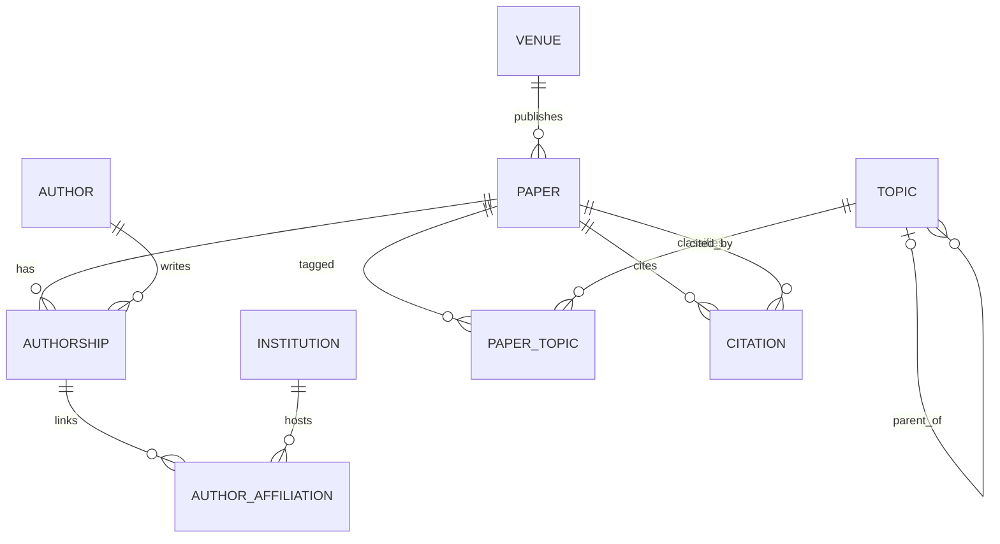

# Person A report chapter: relational core

## Design goals

The relational store is the source of truth for entity identifiers, paper metadata, authorship, affiliations, topics, and in-scope citation edges. OpenAlex IDs are stored as text so the same IDs can link documents in MongoDB. Long-form abstracts, TLDRs, and vectors are passed to the NoSQL layer through `papers_content.jsonl`.

## ER design and normalization

The design is in third normal form. Each entity's descriptive attributes depend on its key: venue details live in `venue`, author details in `author`, and topic hierarchy names in `topic`. Many-to-many relations are represented by `authorship`, `paper_topic`, and `citation`. Affiliations are tied to an author-paper authorship because institutions may differ across an author's papers. Multi-valued authors, topics, and references are not stored as delimited attributes in the relational tables.

`paper` has one row per canonical OpenAlex work. Partial unique indexes on DOI and arXiv ID enforce the deduplication policy where those identifiers exist. Papers missing either identifier remain valid because these values are nullable. `citation` includes only links for which both endpoints were selected into the corpus. Its composite primary key prevents duplicate directed edges.

## Ingestion and source lineage

The data window is first submissions during 2018-2024 in arXiv categories `cs.LG` or `cs.AI`. `fetch_arxiv_manifest.py` records the category membership and first submission date. This membership list is important because OpenAlex's topic hierarchy is a different classification and cannot prove arXiv category inclusion.

OpenAlex supplies the normalized entities, work metadata, topic hierarchy, and references. The pipeline deduplicates OpenAlex records by normalized DOI or arXiv ID and rewrites reference identifiers to the selected canonical record. The API key is read from `OPENALEX_API_KEY`, never stored in this repository. Semantic Scholar enrichment is optional and best effort: `enrich_semantic_scholar.py` retrieves TLDRs and references, while the loader maps those references into the in-corpus graph where an arXiv ID or DOI matches.

The `load_openalex.py` process writes normalized entities in batches of 500 in a transaction per batch. It sets citation counts to zero and derives the project's in-scope counts from the citation graph. It then bulk-loads distinct citation edges and recomputes PageRank and the analytics views. Re-running the loader is safe for entity rows because insert conflicts update the canonical metadata; citation edges use `ON CONFLICT DO NOTHING`.

## Database features

- Constraints enforce non-empty titles and names, valid publication years, non-negative counts, valid venue types, uniqueness of author order per paper, and valid foreign-key relationships.
- Trigram GIN indexes support fuzzy matching of author, venue, and paper-title strings. Exact IDs remain the join keys.
- `citation_chain(paper_id, depth)` uses a recursive query with cycle protection and a 20-edge maximum.
- `coauthors(author_id)` supports the reviewer finder conflict check.
- A citation trigger maintains in-corpus citation counts. A PL/pgSQL `compute_pagerank` procedure runs a bounded iterative PageRank calculation over the directed citation graph.
- Materialized views provide topic-by-year counts and author statistics. `refresh_analytics()` refreshes them after an ingest batch.
- `scholarql_reader` receives `SELECT` access only, plus an eight-second statement timeout and read-only default transactions.

## Performance study method

`db/bench/performance.sql` contains ten representative plans for lookup, join, fuzzy name linking, citation traversal, trend aggregation, author counts, DOI lookup, incoming citations, institution collaboration, and venue/year totals. Compare the baseline and indexed conditions on the same loaded dataset and database instance. Save JSON `EXPLAIN (ANALYZE, BUFFERS)` plans, record the PostgreSQL version, hardware, row counts, and cache state, and repeat each timed query at least 30 times. `latency_benchmark.py` reports median and p95 latency in milliseconds for each condition.

### Results (measured)

Run by B with `engine/scripts/index_study.py` on PostgreSQL 17.12 (Debian 17.12-0+deb13u1), INTEL(R) XEON(R) PLATINUM 8573C (9 logical CPUs), over a deterministic synthetic workload of 50,000 papers, 199,886 citations, 18,000 authors and 150,000 authorships (`db/bench/scale_fixture.sql`). Each query ran 40 timed times per condition; warm cache, ABBA order (baseline, indexed, indexed, baseline), parallel workers and JIT off. Times include client execution and fetch; the returned rows were identical under both conditions. Raw data and `EXPLAIN (ANALYZE, BUFFERS)` plans: `engine/results/index_results.json`, `index_plans.json`, `index_timings.csv`.

| Query | Median, no secondary indexes (ms) | Median, indexed (ms) | p95 no idx / idx (ms) | Speed-up | Buffers hit (no idx → idx) |
|---|---:|---:|---:|---:|---:|
| `venue_year_join` | 5.48 | 0.81 | 6.43 / 1.13 | 6.8× | 1847 → 394 |
| `citation_ranking` | 8.68 | 0.21 | 10.26 / 0.42 | 41.3× | 1511 → 54 |
| `recursive_citations` | 0.69 | 0.63 | 0.89 / 0.94 | 1.1× | 83 → 83 |
| `fuzzy_author` | 25.31 | 0.42 | 27.53 / 0.61 | 59.8× | 133 → 45 |
| `topic_trend_base` | 108.59 | 106.81 | 115.71 / 110.53 | 1.0× | 1783 → 1783 |
| `topic_trend_view` | 0.32 | 0.27 | 0.56 / 0.42 | 1.2× | 2 → 2 |
| `author_papers` | 9.22 | 0.31 | 11.39 / 0.48 | 30.2× | 835 → 35 |
| `doi_lookup` | 0.18 | 0.12 | 0.37 / 0.21 | 1.5× | 4 → 4 |
| `incoming_citations` | 0.54 | 0.42 | 0.78 / 0.75 | 1.3× | 140 → 129 |
| `title_contains` | 14.53 | 0.44 | 18.81 / 0.81 | 33.4× | 1511 → 160 |

The secondary indexes help where the planner can avoid a full scan: trigram fuzzy author matching (~60×), ranking by citation count (~41×), an author's papers (~30×), title search (~33×) and the venue/year join (~7×). They barely change queries that already used primary-key or constraint indexes (DOI lookup, recursive citations, incoming citations) or that must aggregate the whole table (`topic_trend_base`, ~107 ms either way). For that one the materialized view `topic_year_trends` is the fix: the same answer in ~0.3 ms, over 300× faster.

These are synthetic records, so they measure the database design, not corpus quality. Re-running on the real 50K harvest (same command, `--dsn` pointing at it) is optional confirmation.

## Schema validation

The migration was applied to a temporary PostgreSQL 18 database, the sample seed loaded, and the down migration exercised. Checks passed for the citation-count trigger, recursive citation function, coauthor function, PageRank score normalization, analytics-view refresh, and reader-role `SELECT` access. A reader `INSERT` was rejected. The temporary database was stopped and removed. The schema now also runs in the shared Docker stack and CI, loaded with B's 353-paper real pilot (`db/seed/`).

## A-owned API and interface

The paper list/detail, citation and trend SQL was merged into the shared FastAPI app (`api/app/routers/papers.py`: `GET /papers`, `/papers/{id}`, `/papers/{id}/citations`, `/trends`) in the agreed response shapes, and the shared Next.js app has the paper library, trends chart, paper page and citation explorer.
