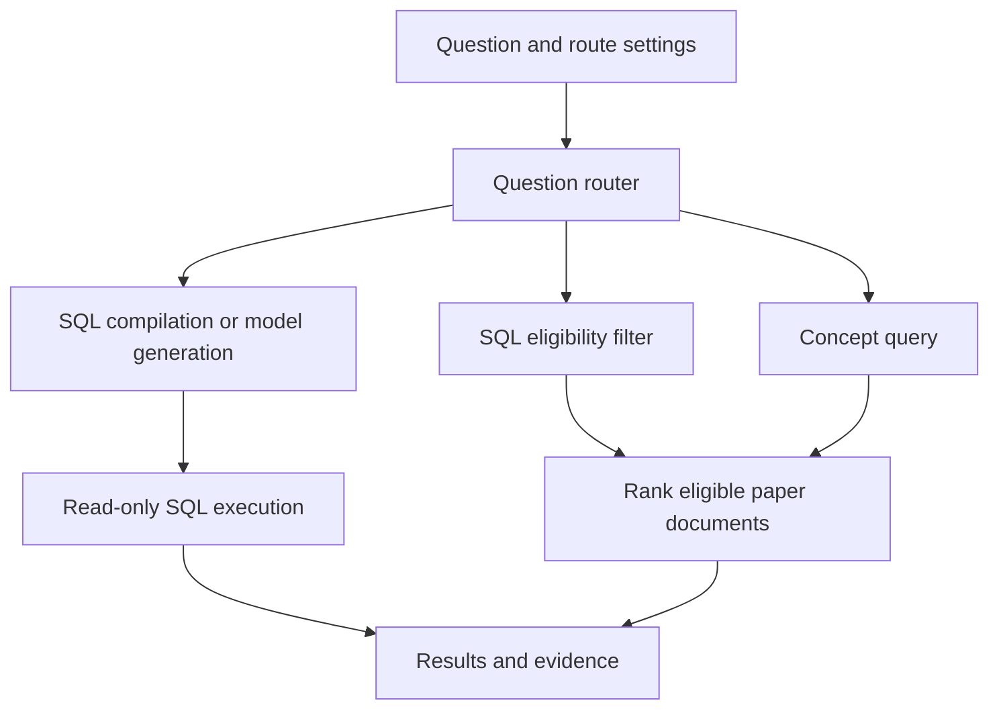

# ScholarQL

ScholarQL is a research literature query engine built on the supplied PostgreSQL schema. It answers structured questions with SQL, ranks papers by concept, and can apply exact database filters before document ranking. The React workbench shows the executed SQL, applied filters, candidate count and source records. It also includes a paper library, citation explorer, publication trends, query history and an evaluation page.

## Open the website on Windows

Extract the entire ZIP and double-click **Start_ScholarQL.cmd**. It creates a Python environment, installs the packages and opens [http://127.0.0.1:8000](http://127.0.0.1:8000). Keep the terminal open while the website is running. The initial installation uses the internet. The included 353-paper pilot then works locally without credentials.

For a manual PowerShell setup, open the folder that contains `run.py`:

```powershell
py -3.11 -m venv .venv
.\.venv\Scripts\python.exe -m pip install -r requirements.txt
.\.venv\Scripts\python.exe run.py --open
```

Use `py -3.12` if that is your installed version. If port 8000 is in use, append `--port 8001` and open [http://127.0.0.1:8001](http://127.0.0.1:8001).

Linux or macOS:

```bash
python3 -m venv .venv
.venv/bin/python -m pip install -r requirements.txt
.venv/bin/python run.py --open
```

The ZIP includes the compiled React app in `web/dist`. To rebuild after editing the frontend, enter `web` and run `npm ci` and `npm run build` with Node 22. Then restart the Python server. The API schema is available at [http://127.0.0.1:8000/docs](http://127.0.0.1:8000/docs).

## Try these questions

| What to show | Enter in the workbench |
| --- | --- |
| Aggregation | Top 5 venues by average citations since 2021 |
| Recursive SQL | Show the citation chain from "Mistral 7B" up to depth 2 |
| Document ranking | Explain how diffusion models generate images |
| Exact filter plus document ranking | Find papers about adapting language models on a small GPU published since 2023. |
| Exact paper lookup | Find arXiv paper 2305.14314 |
| Set difference | Papers that cite "LoRA: Low-Rank Adaptation of Large Language Models" but not "Mistral 7B" |

In **Citation explorer**, try arXiv ID `2407.21783`, select **References** and compare one hop with two. A count of zero means the frozen corpus has no observed edge matching the query.

## How it works



- **Relational queries.** The local compiler recognizes lookup, joins, aggregates, set operations and recursive citations. It asks for explicit wording where it cannot parse the intent. With a configured Gemini or Groq model, the API supports schema-aware zero-shot, few-shot and few-shot with one feedback-driven retry.
- **Document queries.** Document records share the canonical `paper_id` with PostgreSQL. The default is local TF-IDF cosine. BM25 and MiniLM cosine are configurable. Conceptual answers show ranked papers and abstracts.
- **Combined queries.** SQL produces the eligible paper IDs. The ranker scores only those candidates and the result includes the filter SQL. Supported filters include year comparisons, year ranges, exact names in quotes after `at`, `by` and `from institution`, quoted topic tags, and minimum incoming citations. Filters combine with AND.
- **Execution controls.** The service parses model SQL as a single read-only SELECT using PostgreSQL's parser. PostgreSQL also checks the query with EXPLAIN before execution, using a SELECT-only reader, read-only transactions, a statement timeout and a result cap.
- **Normalized data.** `paper` links to `venue`. `authorship` and `paper_topic` model many-to-many relationships, and `author_affiliation` records affiliation for a specific paper's byline. `citation` links two papers and maintains incoming counts. PostgreSQL includes recursive functions, PageRank and materialized trend and author views.

## Run PostgreSQL and MongoDB

From the project folder, run:

```powershell
docker compose up --build
```

Open [http://127.0.0.1:8000](http://127.0.0.1:8000). The Compose initialization service applies the supplied PostgreSQL migration, loads the pilot, creates the read-only API role and upserts MongoDB documents. The browser should show PostgreSQL and MongoDB in the top bar. Compose exposes the website on localhost. For local environment setup outside Compose, see [Data and deployment](paper/DATA_AND_DEPLOYMENT.md).

### Optional dense retrieval

Run these commands with the Python environment you use for ScholarQL:

```powershell
python -m pip install -r requirements-dense.txt
python -m scripts.download_model
$env:SCHOLARQL_RETRIEVAL = "minilm"
python run.py
```

With MongoDB, `python -m scripts.bootstrap mongo --dense` stores vectors alongside abstracts. The current pilot benchmark uses exact CPU cosine. See the deployment notes for setting up Atlas Vector Search.

## Experiments for the paper

| Study | Recorded run |
| --- | --- |
| SQL execution | 100 questions and gold queries, 25 in each of four tiers. Gold and predicted outputs were compared on the PostgreSQL pilot and a counterfactual snapshot. |
| Retrieval | 24 judged questions, including 16 with hard filters. The study compares BM25, TF-IDF and MiniLM, and tests filter placement at rank 5. |
| PostgreSQL performance | 50,000 deterministic synthetic papers, 10 queries, 40 timed repetitions per condition and query, and raw EXPLAIN ANALYZE BUFFERS JSON. |

Raw measurements and summaries are in `results/`. The two benchmark files are in `data/`. The **Evaluation** page reads the recorded experiment outputs and provides downloads. [Reproduction steps](paper/REPRODUCE.md)

The real-data pilot is a convenience sample. Its 353 records and 325 observed citation edges support the retrieval and SQL studies. The 50,000-paper workload measures PostgreSQL timing on synthetic data. The local compiler matched 80 canonical questions and abstained on 20 paraphrases. Live LLM scores (GPT-OSS-120B on Groq) and the 49,478-paper real harvest are now measured: see `docs/team/llm-benchmark-results.md`.

## Project files

| Location | Contents |
| --- | --- |
| `scholarql/` | FastAPI, SQL generation and validation, routing, retrieval and evidence |
| `web/src/` | React interface and styling |
| `db/migrations/` | PostgreSQL schema from the supplied database archive |
| `db/bench/` | Synthetic workload and index conditions |
| `pipeline/` | arXiv/OpenAlex harvesting, optional Semantic Scholar enrichment, relational loader and document extraction |
| `data/` | Real pilot, source manifest, 100 gold SQL questions and graded retrieval labels |
| `scripts/` | Bootstrap tools, model installation and experiment runners |
| `paper/` | Research brief, viva explanation, deployment and reproduction notes |

Run `python -m unittest discover -s tests -v` to check query routing, graph directions, evidence, and SQL retry behavior.
