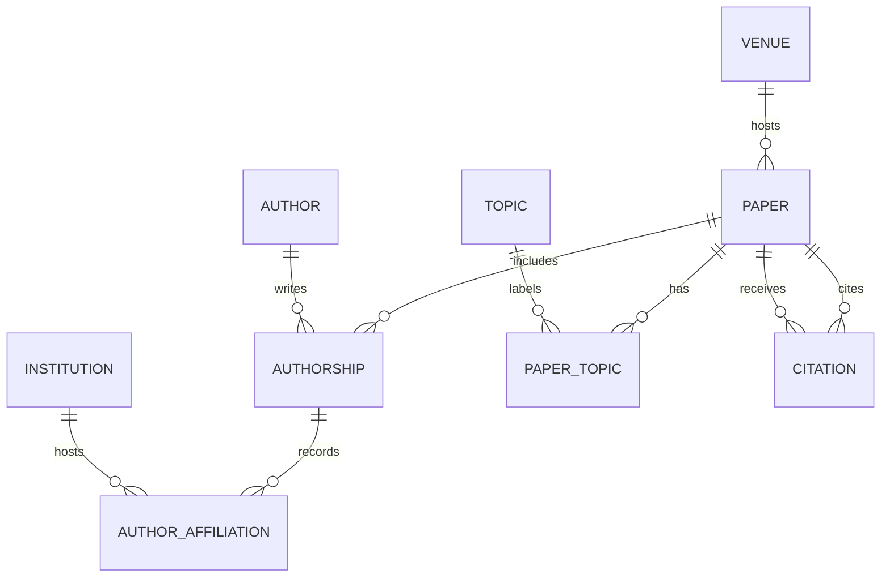

# Explain ScholarQL in a viva

**30-second overview.** ScholarQL lets researchers query papers in plain English. PostgreSQL stores paper metadata and citation relationships. MongoDB stores abstracts, text embeddings and query history in the full setup. The router chooses exact SQL, document ranking or both. A combined question first selects eligible paper IDs in SQL and then ranks only those paper documents. Every result has evidence such as the SQL, matched papers and their sources.

## Walk through the three routes

| Question | What runs | What the user sees |
| --- | --- | --- |
| Top 5 venues by average citations since 2021 | Join papers to venues, filter years, group venues, average observed incoming citations, sort and limit | Venue rows with averages and the generated SQL |
| Explain how diffusion models generate images | Encode the concept and rank the title and abstract documents | Relevant papers, abstracts and source links |
| Find papers about adapting language models on a small GPU published since 2023 | SQL lists in-scope IDs satisfying the year filter. Document ranking scores eligible IDs for efficient adaptation | Ranked papers, year filter, candidate count and filter SQL |

## Explain the relational design

Venues, authors, and institutions have their own keys. A paper can have many authors, and an author can appear on many papers, which is why `authorship` uses a composite key. Affiliations are tied to each byline so an author's affiliation can differ across papers. `citation(citing_id, cited_id)` is a directed edge. The trigger maintains each paper's incoming count. The shared `paper_id` connects the relational metadata to the abstract and optional embedding document.

**What does recursion do?** A recursive CTE starts at the chosen paper and follows the edges for a bounded number of hops. It reports the nearest depth to each reached reference. The citation explorer can also reverse direction to show papers that cite the starting paper.

**What is the research question?** Does using SQL to apply hard metadata filters before top-k document ranking improve retrieval of eligible papers? On 16 judged hybrid questions, MiniLM Recall@5 was 0.750 when filtering first and 0.583 when filtering after the first five. The observed gain was 0.167. BM25 produced the highest nDCG in this labeled subset, and TF-IDF gave the highest Recall@5.

**Why a second database for SQL evaluation?** A query can coincidentally return the correct rows on one dataset. The counterfactual changes dates and citations while preserving the schema and entity vocabulary. The answers to 73 of the 100 gold questions changed. A prediction had to match the reference result on each snapshot.

**Why do some indexes show larger improvements?** Fuzzy author, selective title, publication-by-author, and top-citation queries can exploit a relevant index. Aggregating almost an entire relation remains expensive. Reading a materialized trend view is faster because the grouping has already been computed.

**What goes into the paper?** Use the actual CSV and JSON evidence. Describe the 353-work pilot, the known wording coverage and paraphrase failure, the graded retrieval evaluation, and the controlled 50,000-paper synthetic workload. The optional LLM prompt ablation and larger real-corpus replication need their own measured runs.
